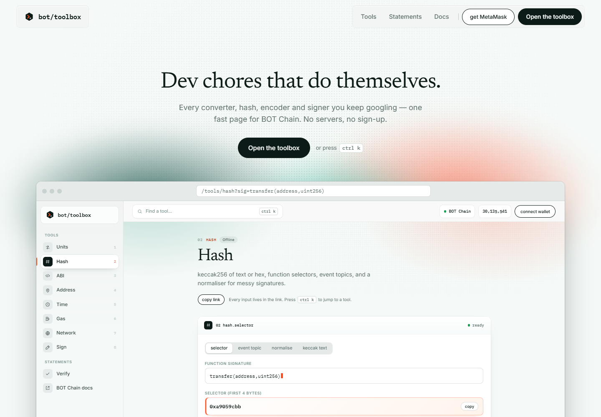
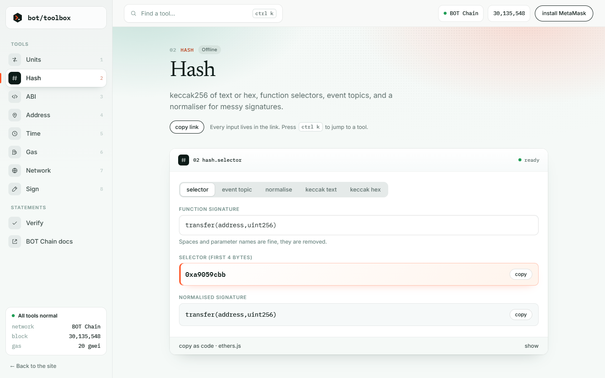
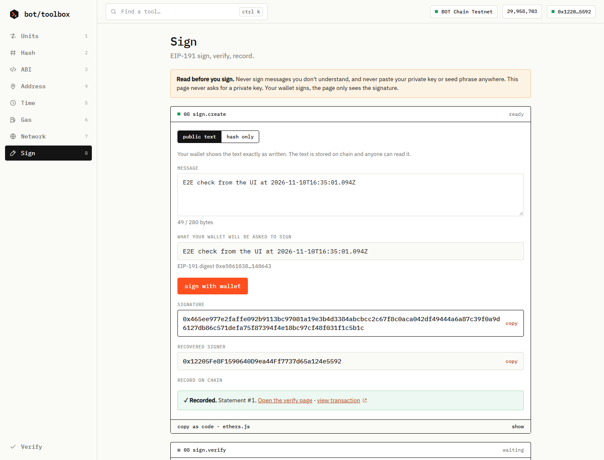
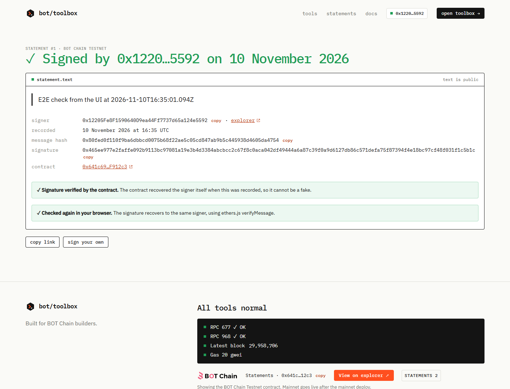
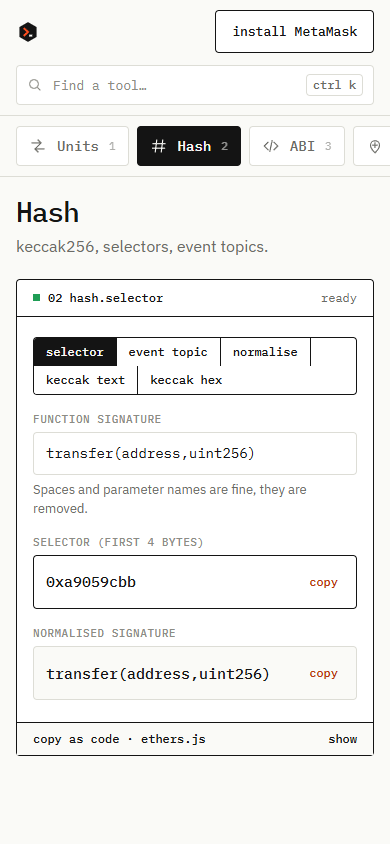

<div align="center">


# BOT Toolbox

**Every little dev tool you keep googling, on one fast page for BOT Chain.**
Converters, hashes, ABI encoding, gas, time and message signing. Plus signed statements anyone can verify on-chain.




</div>

## What it is

BOT Toolbox is a static website with eight developer tools that run in your browser, a command bar (ctrl K), and a small contract, **Statements**, where people record messages they signed with their wallet. There is no server, no account and no API key. Every tool works offline except the ones that read the chain.

| Tool | What it does |
| --- | --- |
| **Units** | wei, gwei, BOT and custom token decimals, each field updates the others |
| **Hash** | keccak256 of text or hex, function selector, event topic, signature normaliser |
| **ABI** | encode a call, decode calldata, encode constructor arguments |
| **Address** | validate, fix the checksum, contract or wallet, balance, explorer links on both networks |
| **Time** | unix seconds and ms to a date and back, relative time, block to approximate time |
| **Gas** | live gas price (refreshes every 3 s) and the cost of N gas units |
| **Network** | mainnet (677) and testnet (968) facts from one config, add to MetaMask, live block height |
| **Sign** | sign with your wallet, verify any signature, record it on BOT Chain |

Every tool keeps its inputs in the URL, so `/tools/hash?sig=transfer(address,uint256)` opens with the answer, and every tool has a **copy as code** drawer with the ethers.js lines that do the same thing. Alt + 1 to 8 jumps between tools.

<div align="center">


</div>

## Signed statements

1. Write a message in the **Sign** tool and sign it with your wallet. Nothing is sent to the chain, no gas.
2. Press **Record on BOT Chain**. The contract recovers the signer itself and stores that address, so a record can never name a signer who did not sign.
3. Open `/verify/<id>`. It shows the text, the signer, the date, "✓ Signature verified by the contract", and re-checks the signature in your browser with ethers.js.

<div align="center">

</div>

### Two signing modes, one function

`personal_sign` over a text string signs `keccak256("\x19Ethereum Signed Message:\n" + byteLength + text)`, but OpenZeppelin's `toEthSignedMessageHash(bytes32)` wraps a 32-byte hash with length 32. A signature over text would not recover to the right address through that bytes32 helper. So `record(messageHash, signature, text)` checks the mode:

- **Public text** (`text` not empty): the wallet signs the readable text, so MetaMask shows exactly what you are signing. The contract requires `keccak256(text) == messageHash` and recovers with `toEthSignedMessageHash(bytes)` over the text.
- **Hash only** (`text` empty): the wallet signs the 32 raw bytes of the hash, and the contract recovers with `toEthSignedMessageHash(bytes32)`. Only the hash is public. The text stays with you, and nobody can get it back from the hash.

Both modes verify in the browser with `ethers.verifyMessage`.

## Contract

`contracts/contracts/Statements.sol`, Solidity ^0.8.20, OpenZeppelin Contracts **5.0.2** (pinned), optimizer 200 runs, `evmVersion: paris`. No owner, no admin, no payments, no upgrade path.

| | |
| --- | --- |
| Testnet (968) | [`0x641c69B5641774A744F26f83B431c67638F912c3`](https://scan.bohr.life/address/0x641c69B5641774A744F26f83B431c67638F912c3) |
| Mainnet (677) | [`0xfeeA1c9F24D12a4D012208cD58925E90DC214F50`](https://scan.botchain.ai/address/0xfeeA1c9F24D12a4D012208cD58925E90DC214F50) |

API: `record(messageHash, signature, text) returns (id)`, `getStatement(id)`, `statementsFor(messageHash)`, `statementsBy(signer)`, `total()`, and the event `Recorded(id, signer, messageHash)`. Text is capped at 280 bytes (bytes, not characters). Malleable (high-s) signatures revert.

### Tests

```bash
cd contracts && npm install && npx hardhat test    # 14 tests
cd .. && npm install && npm test                   # 19 tests for the tool logic
```

The contract tests sign with two different wallets, record, read back and check with `ethers.verifyMessage`. They also cover forged and malformed signatures, a high-s signature, a text and hash mismatch, the 280 byte cap, the views and the revert on unknown ids.

## Run it

```bash
npm install
npm run dev          # http://127.0.0.1:5173
npm run build        # type-check and production build into dist/
```

Stack: Vite, React 18, TypeScript, React Router, ethers v6, GSAP 3.13 (ScrollTrigger, CustomEase), self-hosted IBM Plex fonts. Deep links such as `/tools/hash` and `/verify/12` work on Vercel through the rewrite in `vercel.json`.

Chains, endpoints and the contract address live in one file, [`src/lib/config.ts`](src/lib/config.ts). `APP_NET` decides which network the app records and verifies on (mainnet).

<div align="center">

</div>

## Limits, said plainly

- **The app records and verifies on BOT Chain mainnet.** The mainnet contract was deployed from Remix and its runtime bytecode was checked against this repo's build (`contracts/scripts/verify-deployment.js`). The testnet contract stays available for testing.
- **Anyone can submit a valid signature.** The recorded signer is always the real signer, but the account that paid for the transaction may be someone else. A record proves a key signed these exact words, not that the words are true or who holds the key.
- **Records are permanent.** There is no delete. Public text stays readable forever. Use hash-only mode for anything private.
- **Public RPCs reset connections now and then.** Reads retry up to three times, and the footer only shows a problem after two failed polls in a row. Offline tools never depend on the RPC.
- **Signing and recording need a wallet** (MetaMask or another EIP-1193 wallet). Every other tool works without one.
- The Gas presets (21,000 transfer, about 50,000 token transfer, about 1,000,000 deploy) are rough examples, real usage varies.
- There are no private-key tools, no typed-data (EIP-712) signing and no transaction-sending tools, on purpose.

## Project layout

```
contracts/         Hardhat 2 project: Statements.sol, tests, deploy, smoke and bytecode-check scripts
contracts/remix/   the same contract with pinned imports, for Remix
src/lib/           config, RPC poller with retry, wallet, Statements client, pure tool logic (+ tests)
src/tools/         the eight tools
src/pages/         home (9 sections), verify, guides, legal
docs/              design spec (measured from the reference study) and the mainnet deploy steps
```

Built for BOT Chain builders. Runs in your browser. Never paste your private key anywhere.
